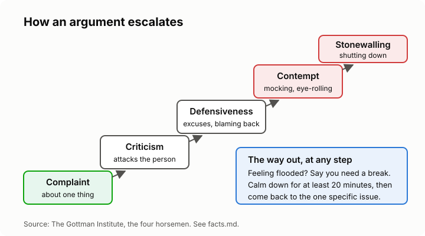

# Lesson 1: Why conflicts escalate
<!-- facts: Escalation and the four horsemen; Conflict styles -->

## By the end, the learner can

- Explain why conflict is normal, and when it becomes harmful.
- Name the four patterns that make arguments spiral, and the antidote to each.
- Notice when they are "flooded", and take a break that actually helps.
- Name the five ways people tend to handle conflict, and which one they reach for.

## Key ideas

**Conflict is normal.** Two people with different needs will disagree. The disagreement isn't the
problem; how it's handled is. A conflict handled well often leaves people closer.

**The four patterns** (the "four horsemen" in `facts.md`) turn a disagreement into a fight:
criticism (attacking who someone is), contempt (mocking or sneering), defensiveness (blaming
back) and stonewalling (shutting down). Each one invites the next. Each has an antidote.

**Complaint versus criticism.** "You didn't call when you said you would" is a complaint about
one thing. "You're so selfish, you never think of anyone else" is criticism of the person. The
first can be fixed; the second can only be defended against.

**Flooding.** When stress hits, the heart races and clear thinking stops. Nothing useful gets
said after that point. Say you need a break, calm down for at least 20 minutes doing something
else (not replaying the fight), then come back. Say when you'll come back, so it isn't walking out.

**Five styles.** People tend to compete, collaborate, compromise, avoid or accommodate
(`facts.md`). None is always right: avoiding is wise for a trivial issue, and harmful for a
serious one.

**When it isn't a conflict.** If one person is afraid of the other, it isn't a disagreement
between equals. Lesson 7 covers this, and the tutor will stop and help if it applies to you.

## Worked example

Lerato asks her brother to stop borrowing her car without asking. He says she's overreacting.
She says he's always been spoiled. He rolls his eyes and walks off. Complaint, defensiveness,
criticism, contempt, stonewalling: all in under a minute, and the car never got discussed.

## Role-play

The tutor plays a family member who borrowed something and brought it back damaged. The learner
raises it. Partway through, the tutor gets a bit defensive. The learner's goal: spot each pattern
as it appears, stay on the one specific complaint, and practise calling a short break if it heats
up. Debrief: which patterns showed up, and who started each one?

## Sources

- [The Gottman Institute: The Four Horsemen](https://www.gottman.com/blog/the-four-horsemen-recognizing-criticism-contempt-defensiveness-and-stonewalling/)
- [Kilmann Diagnostics: the Thomas-Kilmann conflict modes](https://kilmanndiagnostics.com/using-the-thomas-kilmann-conflict-mode-instrument/)
