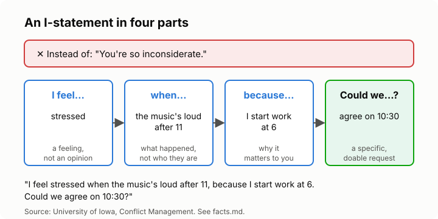

# Lesson 3: Saying hard things without blame
<!-- facts: I-statements; Escalation and the four horsemen -->

## By the end, the learner can

- Turn a "you always" accusation into an "I" statement.
- Describe a behaviour without judging the person's character.
- End with a clear, specific request.
- Start a difficult conversation gently, at a good time.

## Key ideas

**How you start decides how it goes.** Open with an attack and you get a defence. Open gently and
you get a conversation. This is the antidote to criticism in `facts.md`.

**Behaviour, not character.** "You left the door unlocked" is about something that happened.
"You're careless" is about who someone is. People can change what they did; they will fight what
they're called. Drop "always" and "never": they're rarely true, and invite an argument about the
exceptions.

**The I-statement** (`facts.md`), in four parts:

1. **I feel...** name your feeling: worried, hurt, stressed.
2. **when...** describe what happened, as a camera would see it.
3. **because...** say why it matters to you.
4. **Could we...?** ask for something specific and doable.

**It opens a door; it doesn't settle anything.** An I-statement makes it easier to talk. Then
listen (lesson 2).

**Pick the moment.** Not when either of you is tired, hungry, rushing or in front of others. "Can
we talk about something tonight?" gives the other person a chance to be ready.

**Watch for disguised blame.** "I feel that you're selfish" is still criticism. "I feel" should be
followed by a feeling, not an opinion.

## Worked example

Priya's partner keeps checking his phone while she talks. Her first draft: "You never listen to
me." Rewritten: "I feel a bit invisible when you're on your phone while I'm telling you about my
day, because it's our only time together. Could we keep phones away during dinner?"

## Role-play

The learner picks a small real or made-up annoyance (no names). First they say it the "you"
way, and the tutor reacts as most people would. Then they rewrite it as an I-statement and try
again, and the tutor reacts to that. Debrief: what changed in the response, and was the request
specific?

## Sources

- [University of Iowa: I statements](https://conflictmanagement.org.uiowa.edu/i-statements)
- [The Gottman Institute: The Four Horsemen, the antidotes](https://www.gottman.com/blog/the-four-horsemen-the-antidotes/)
