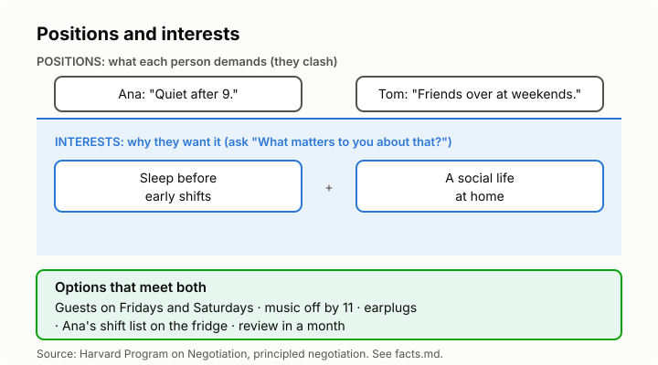

# Lesson 4: Negotiating and finding middle ground
<!-- facts: Principled negotiation; Conflict styles -->

## By the end, the learner can

- Tell a position (what someone demands) from an interest (why they want it).
- Come up with several options before picking one.
- Use a fair standard both sides can accept, instead of a battle of wills.
- Work out their walk-away option before they start.

## Key ideas

**Positions and interests.** A position is the demand: "I want the bigger room." An interest is
the reason: more space for a desk, or paying the same rent as everyone else. Positions clash.
Interests often don't, or can be met in more than one way. Ask "What matters to you about that?"

**Separate the people from the problem.** You're both on one side of the table and the problem
is on the other. Listening (lesson 2) and I-statements (lesson 3) do this.

**More than one option.** Brainstorm before you decide, without judging ideas yet. Then pick the
one that meets the most interests on both sides. Splitting the difference (compromise) is one
option, not the only one; often you can do better (collaborate).

**Fair standards.** When you can't agree, look for an outside measure: what the lease says, the
price of similar items, a rota, taking turns, each paying by use. "What would be fair?" beats
"Because I said so."

**Know your BATNA** (`facts.md`): what you'll do if you can't agree. Move out, buy your own,
go to the landlord, accept it. If a deal is worse than your BATNA, you can walk away.

**Write it down.** Agree who does what, from when, and when you'll check it's working.

## Worked example

Ana works early shifts; her flatmate Tom has friends over at weekends. Positions: "Quiet after
9" against "My home, my weekends." Interests: Ana needs sleep on work nights; Tom wants a social
life. Options: guests on Friday and Saturday only, music off by 11 on those nights, earplugs
paid for by Tom, Ana's shift list on the fridge. They agree three of these and review in a month.

## Role-play

The tutor plays a flatmate, sibling or partner with a clashing position (sharing a car, splitting
bills, or holiday plans). The learner must ask about the tutor's interests, share their own, come
up with at least three options and agree one. The tutor holds to the position until asked why.
Debrief: what were the hidden interests, and what was the learner's BATNA?

## Sources

- [Harvard Program on Negotiation: Principled negotiation](https://www.pon.harvard.edu/daily/negotiation-skills-daily/principled-negotiation-focus-interests-create-value/)
- [Harvard Program on Negotiation: What is BATNA?](https://www.pon.harvard.edu/daily/batna/translate-your-batna-to-the-current-deal/)
